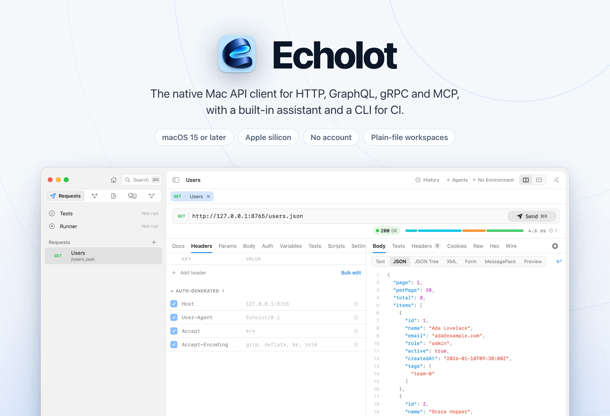
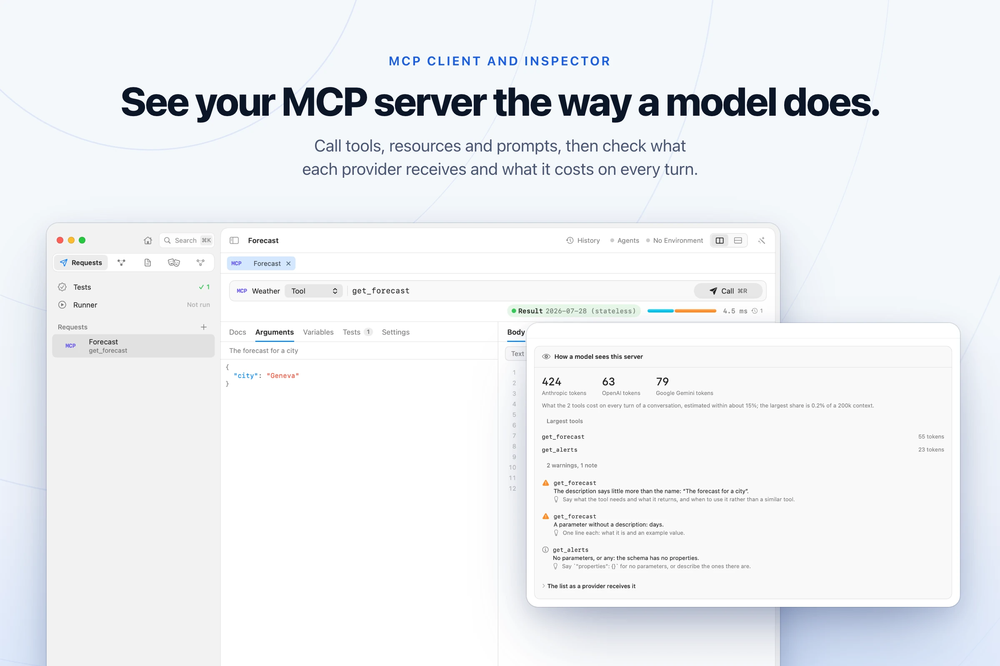
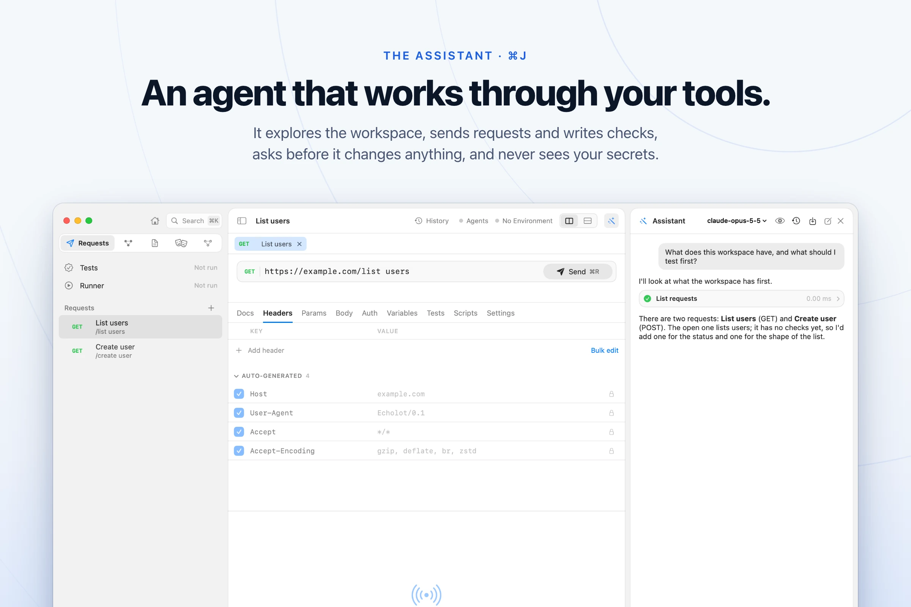
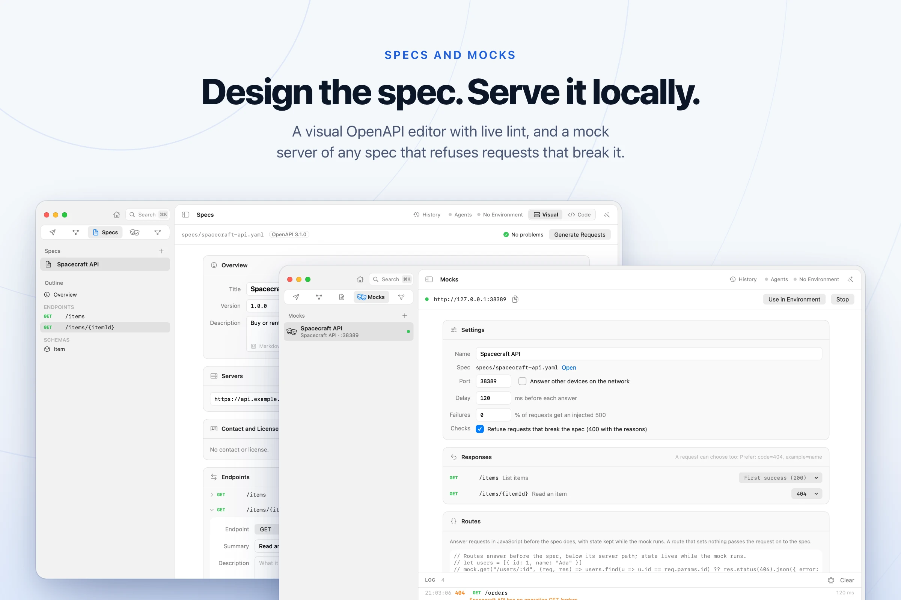
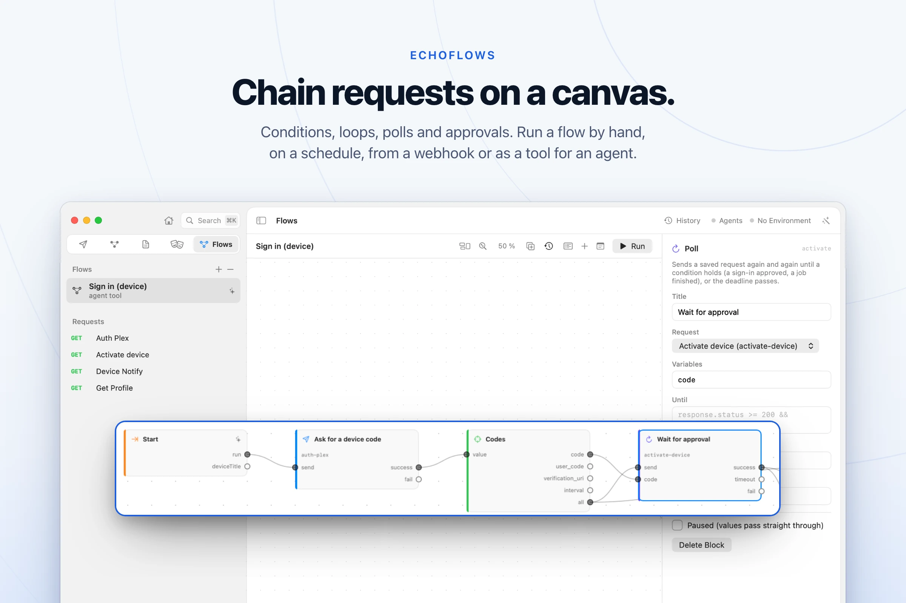
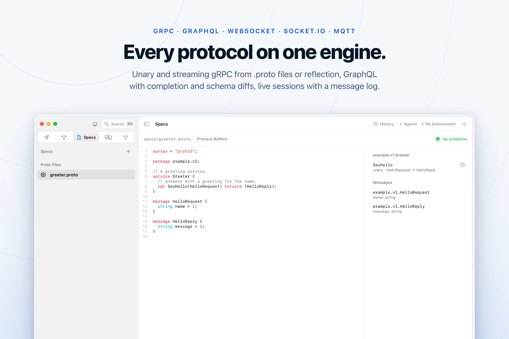
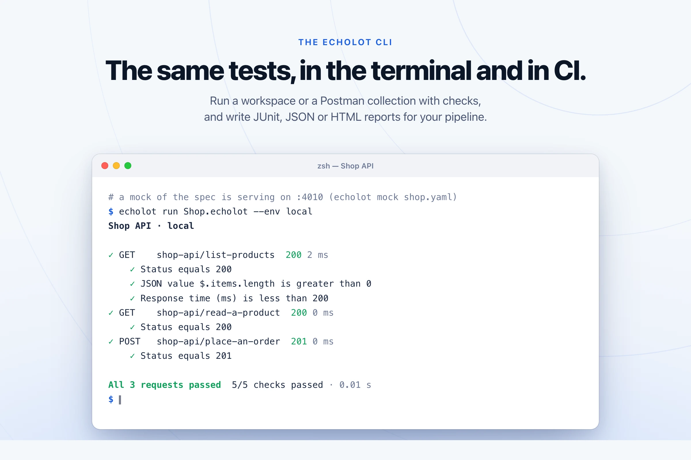

<div align="center">

<picture>
  <source media="(prefers-color-scheme: dark)" srcset="assets/hero-dark.webp">
  
</picture>

<br>

[](https://github.com/staticdreams/echolot-public/releases/latest)


### [Download for Mac](https://github.com/staticdreams/echolot-public/releases/latest) · [echolot.dev](https://echolot.dev) · [Release notes](https://github.com/staticdreams/echolot-public/releases)

</div>

<br>

An *Echolot* is German for an echo sounder: it sends a ping, measures what comes back and maps what lies beneath. That is the whole idea. Send a request, see exactly what went over the wire, understand the API.

Echolot is a native macOS client for **HTTP, GraphQL, gRPC, WebSocket, Socket.IO, MQTT and MCP**. It comes with a built-in AI assistant, an MCP server that lets agents use your APIs without seeing your secrets, and an `echolot` command-line tool that runs the same checks in your pipeline.

- **Native, not a web view.** SwiftUI and AppKit, the Keychain, Quick Look, and menus and shortcuts that behave like a Mac app's.
- **Built for heavy payloads.** Bodies stream to disk instead of memory. A 2 GB download peaks under 30 MB of RAM, and a 500 MB JSON response opens in milliseconds.
- **Wire-level truth.** Raw bytes, exact header order and casing, every redirect hop and a full timing breakdown. Anything automatic can be seen and switched off.
- **Local-first and Git-friendly.** A workspace is a folder of readable TOML files. No account, no cloud, and secrets stay in the Keychain, never in files.
- **One engine everywhere.** The app, the CLI and AI agents go through the same tool layer, so a check that passes on your Mac passes in CI.

## Download

| | |
| --- | --- |
| **The app** | `Echolot-<version>.dmg` from the [latest release](https://github.com/staticdreams/echolot-public/releases/latest). Notarized, for macOS 15 or later on Apple silicon. |
| **Updates** | Built in: Echolot › Check for Updates…. Every update is signed, and the feed is [`appcast.xml`](appcast.xml) in this repo. |
| **The CLI** | Inside the app at `Echolot.app/Contents/Helpers/echolot`, or on its own as `echolot-<version>-macos.zip` (universal). |
| **Claude Desktop** | `Echolot-<version>.mcpb` installs Echolot's MCP server as a Claude Desktop extension. |

To put the bundled CLI on your path, choose **Echolot › Install Command-Line Tool…** (also in Settings › General). It links `echolot` into `/opt/homebrew/bin` or `/usr/local/bin`.

## A closer look

<picture>
  <source media="(prefers-color-scheme: dark)" srcset="assets/mcp-dark.webp">
  
</picture>

**MCP client and inspector.** Connect over stdio, Streamable HTTP or HTTP+SSE, then browse and call tools, resources and prompts, and answer elicitation and sampling requests. *How a model sees this server* shows the tool list as each provider receives it, what it costs on every turn, and the names, descriptions and schemas a model would stumble over. Both the stateless 2026 revision and the `initialize`-based revisions back to 2024-11-05 are supported.

<br>

<picture>
  <source media="(prefers-color-scheme: dark)" srcset="assets/assistant-dark.webp">
  
</picture>

**The Assistant** (⌘J) works through the same tools you do. It explores the workspace, sends requests, writes checks and builds flows, specs and mocks, and asks before it sends or changes anything.

- Bring your own model and key: Anthropic, OpenAI, Gemini, or OpenAI-compatible servers such as Ollama, LM Studio and OpenRouter. Keys live in the Keychain, and each conversation shows its tokens and estimated cost.
- Secret values are redacted from everything the model sees, and text planted in a response, spec or note cannot make it send anything to another host.
- Save a conversation as a folder of requests with checks, or as a flow, and share it with your team to replay without a model.
- Run Claude Code, Codex, Gemini CLI or any Agent Client Protocol agent in the panel, with Echolot's tools and approvals.
- With Apple Intelligence, summarize a response, explain an error or suggest checks on the Mac itself.

<br>

<picture>
  <source media="(prefers-color-scheme: dark)" srcset="assets/specs-mocks-dark.webp">
  
</picture>

**Specs and mocks.** Design OpenAPI documents in a visual editor or as code, with live lint. Visual edits change only the lines they touch, so Git diffs stay small. Serve any spec as a local mock server with examples, delays, injected failures and checks that refuse requests that break the spec. Add routes in JavaScript that keep state between requests.

<br>

<picture>
  <source media="(prefers-color-scheme: dark)" srcset="assets/flows-dark.webp">
  
</picture>

**EchoFlows.** Chain requests, conditions, loops, polls and approvals on a canvas. Run a flow by hand, on a schedule, from a webhook, or hand it to an agent as a tool. Drag requests in from the sidebar, draw links from any port and copy blocks between flows.

<br>

<picture>
  <source media="(prefers-color-scheme: dark)" srcset="assets/grpc-dark.webp">
  
</picture>

**Every protocol on one engine.**

- **HTTP** /1.1, /2 and /3 (QUIC, on macOS 27 and later), request bodies streamed from disk, and a raw mode that sends exactly what you typed, malformed requests included
- **gRPC** unary and streaming calls from `.proto` files or server reflection, with messages written as JSON, deadlines, compression and TLS with client certificates
- **GraphQL** schemas from SDL or introspection, with completion and validation as you type, a query builder that ticks fields in the schema tree, and schema diffs graded breaking, dangerous or safe
- **WebSocket, Server-Sent Events, Socket.IO** (4, 3 and 2) and **MQTT** (3.1.1 and 5.0) sessions with a message log
- **Auth:** Basic, Bearer, Digest, API keys, OAuth 2.0, JWT, AWS Signature, Hawk, Akamai EdgeGrid and NTLM, inherited from folders and the workspace
- Proxies (HTTP, HTTPS, SOCKS5), client certificates and custom CA trust per host

<br>

<picture>
  <source media="(prefers-color-scheme: dark)" srcset="assets/cli-dark.webp">
  
</picture>

## The CLI

`echolot` runs the same engine as the app: send one request, run a whole workspace or a Postman collection, lint specs, diff GraphQL schemas, serve mocks and check MCP servers.

```bash
echolot send https://api.example.com/users -i -v --wire        # one request, with the bytes on the wire
echolot import collection.json -w "My API.echolot"             # cURL, Postman, OpenAPI, Insomnia, HAR, Paw, Bruno
echolot run "My API.echolot" --env staging --reporter junit --out results.xml
echolot run collection.json                                    # a Postman collection, as is
echolot spec lint openapi.yaml --strict
echolot graphql diff before.graphql after.graphql              # exits 1 on a breaking change
echolot grpc call http://localhost:50051 shop.v1.Catalog/ListProducts -d '{"pageSize": 10}'
echolot mock openapi.yaml --port 4010 --delay 200
echolot flow run sign-in -w "My API.echolot" --env production
echolot mcp check --quality --strict --url http://127.0.0.1:3000/mcp
```

The Assistant runs headless too, with a policy file in place of approvals:

```bash
ANTHROPIC_API_KEY=… echolot agent "Check every request and report what fails" \
  -w "My API.echolot" --policy-file ci-policy.toml --json
```

## For AI agents

Echolot is also an MCP server, so Claude Code, Codex, Cursor, VS Code and Claude Desktop can explore, call and test your APIs **with your environments and secrets, without ever seeing them**.

```bash
echolot mcp setup claude-code -w "My API.echolot"   # also claude-desktop, cursor, vscode, codex
echolot mcp serve "My API.echolot" --policy readonly
```

- Every request an agent sends goes through the same tool layer as yours and lands in history like any other.
- Secret values are redacted from everything an agent receives, errors included, whether raw, JSON, percent-encoded or Base64.
- A policy (`standard`, `readonly` or `permissive`) decides what an agent may do, and sends and changes ask you first unless you allow them.
- A folder can offer its requests to agents as tools, one per request, with parameters from its variables and never its secrets.

## Workspaces are plain files

A workspace is a folder with one TOML file per request, so it diffs, merges and reviews well.

```
My API.echolot/
├── workspace.toml
├── environments/
│   ├── staging.toml
│   └── production.toml
├── requests/
│   └── users/
│       ├── list-users.req.toml
│       ├── search.gql.toml
│       └── list-products.grpc.toml
├── specs/openapi.yaml
├── mocks/users.toml
└── flows/sign-in.flow.toml
```

```toml
# requests/users/list-users.req.toml
echolot = 1
name = "List users"
method = "GET"
url = "{{baseURL}}/users?page=1"

[[assertions]]
target = "status"
check = "equals"
expected = "200"

[[assertions]]
target = "json"
path = "$.items.length"
check = "greater-than"
expected = "0"
```

Bring your existing work: **Postman** collections and environments, **OpenAPI** 3.x and **Swagger** 2.0, **Insomnia**, **Bruno**, **HAR**, **cURL** and **Paw**.

## Also in the box

- Checks on status, headers, JSONPath, body, time, size, JSON Schema, OpenAPI responses and MCP results, with no code
- Postman-compatible `pm.*` scripts in a sandboxed QuickJS runtime, including `pm.sendRequest`
- A runner with data files and iterations side by side, writing JUnit, JSON or HTML reports
- Viewers for text, hex, JSON and XML trees, images and more that stay smooth at hundreds of megabytes
- A searchable history of every exchange, with side-by-side comparison, and stored bodies optionally encrypted at rest
- Quick Send: a menu bar panel (⌃⌥Space) that sends any saved request without leaving what you are doing
- **Run Request** and **Run Folder** actions for the Shortcuts app

## Performance

Performance budgets are release gates: each one is an automated benchmark, and a build that misses one does not ship. Results on an Apple silicon Mac:

| Scenario | Result | Budget |
| --- | --- | --- |
| App overhead, request to first byte (local server) | 0.1 ms | ≤ 50 ms |
| Peak memory, 2 GB download (HTTP/1.1 · HTTP/2 · HTTP/3) | 17 · 28 · 50 MB | ≤ 300 MB |
| First screen of a 500 MB body | 0.3 ms | ≤ 200 ms |
| Search a 500 MB body: first match · full count | 84 ms · 240 ms | ≤ 300 ms · ≤ 2 s |
| Expand a JSON array with 1,000,000 children | 30 ms | ≤ 100 ms |
| GraphQL completion on an 8 MB schema, p95 | 0.014 ms | ≤ 50 ms |

## Privacy

No account and no cloud: your workspaces stay on your Mac. Secrets live in the Keychain. Usage analytics are off until you opt in (Settings › Privacy).

## About this repository

Echolot's source code is private. This repository holds its public side: the [releases](https://github.com/staticdreams/echolot-public/releases), the update feed [`appcast.xml`](appcast.xml) (served at `https://staticdreams.github.io/echolot-public/appcast.xml`), and a place to [report a bug or ask for a feature](https://github.com/staticdreams/echolot-public/issues).
